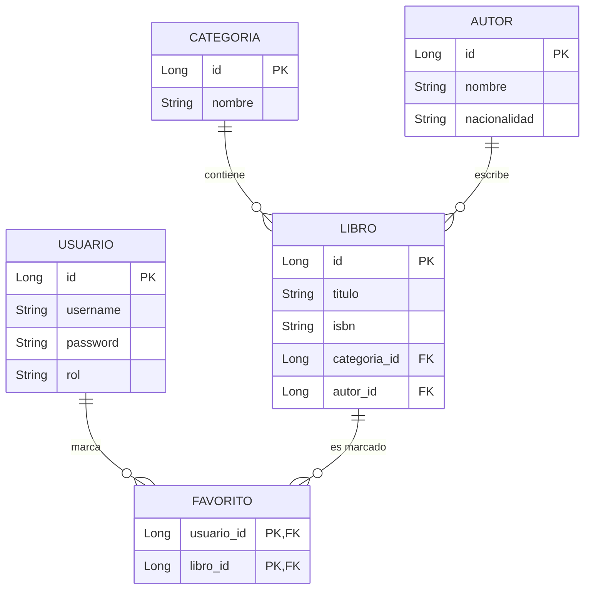
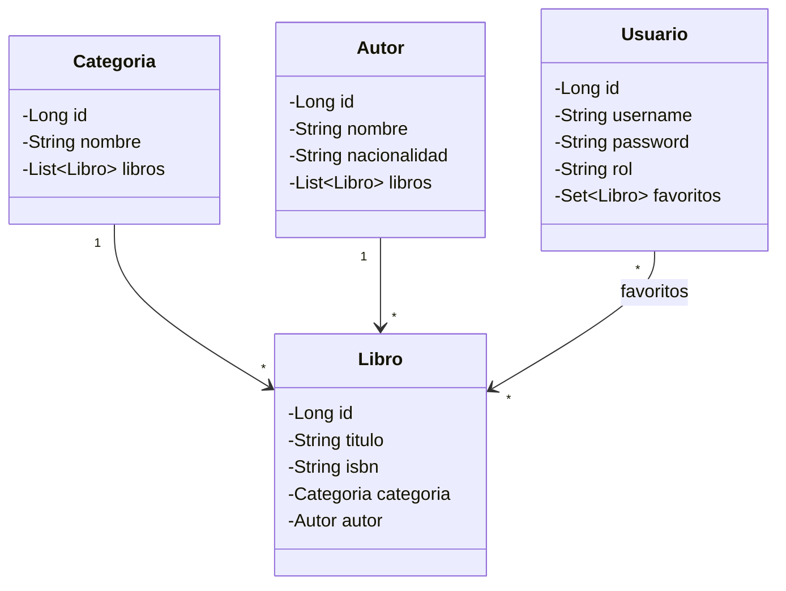

# BiblioTec – API REST de gestión de biblioteca

## 1. Descripción general

BiblioTec será una API REST desarrollada con Java y Spring Boot que permitirá
administrar el catálogo de libros de una biblioteca, a sus usuarios y los
préstamos realizados. Permite dar de alta, consultar, modificar y dar de baja
libros, usuarios y préstamos, y se ejecuta dentro de un contenedor Docker
para garantizar un entorno uniforme.

## 2. Integrantes del equipo

- Alvarado Rojas Sirce Yisel
- Ceballos Maya César Ricardo
- Hernandez Vazquez Karla Daniela

## 3. Requerimientos iniciales

| ID | Requerimiento | Descripción | Prioridad |
|---|---|---|---|
| RF1 | CRUD de libros | Alta, consulta, modificación y baja de libros | Alta |
| RF2 | CRUD de usuarios | Alta, consulta, modificación y baja de usuarios | Alta |
| RF3 | Registro de préstamos | Crear un préstamo asociando un libro y un usuario | Alta |
| RF4 | Devolución de libros | Marcar un préstamo como devuelto y actualizar el inventario | Media |
| RF5 | Consultas filtradas | Buscar libros por título, autor o categoría y listar préstamos por usuario | Media |

## 4. Funcionalidades que Spring Boot puede resolver con sus paquetes

| Funcionalidad | Paquete |
|---|---|
| Exposición de endpoints REST | spring-boot-starter-web |
| Conexión a base de datos y ORM | spring-boot-starter-data-jpa (+ H2 o PostgreSQL) |
| Validación de datos de entrada | spring-boot-starter-validation |
| Autenticación y autorización | spring-boot-starter-security + JWT (jjwt) |
| Logs y monitoreo | Logging de Spring Boot (SLF4J/Logback) y spring-boot-starter-actuator |
| Documentación de la API | springdoc-openapi (Swagger UI) |
| Manejo global de errores | @ControllerAdvice / @ExceptionHandler |
| Pruebas | spring-boot-starter-test |

## 5. Cómo ejecutar

### Opción 1: Dev Container (VS Code)
1. Abrir el repositorio en VS Code con la extensión *Dev Containers*.
2. Seleccionar "Reopen in Container".
3. Ejecutar `mvn spring-boot:run`.
4. Visitar `http://localhost:8080/hello`.

### Opción 2: Docker Compose
```bash
docker compose up --build
```

### Secreto JWT
Por defecto se usa un valor de desarrollo definido en `application.properties`.
Para usar uno propio:
```bash
openssl rand -base64 32
export JWT_SECRET="<resultado>"
```

## 6. Relaciones del modelo

Relaciones 1 a muchos:
- Una **Categoría** tiene muchos **Libros**.
- Un **Autor** tiene muchos **Libros**.

Relación muchos a muchos:
- Un **Usuario** puede marcar muchos **Libros** como favoritos y un **Libro**
  puede ser favorito de muchos **Usuarios**. JPA crea la tabla intermedia `favoritos`.





## 7. Documentación con Swagger

La API está documentada con springdoc-openapi. Con la aplicación en ejecución,
abrir `http://localhost:8080/swagger-ui.html`.

## 8. Autenticación con JWT

Todos los endpoints requieren un token JWT, excepto `/hello`, `/auth/**` y Swagger.

1. Registrar un usuario con `POST /auth/register`:
   ```json
   { "username": "admin", "password": "1234" }
   ```
2. Iniciar sesión con `POST /auth/login` y copiar el `token` de la respuesta.
3. En Swagger, pulsar **Authorize**, pegar el token (sin la palabra `Bearer`) y confirmar.
4. Sin token, la API responde `401`.

Con herramientas como curl o Postman, enviar el encabezado
`Authorization: Bearer <token>`.

## 9. Endpoints

| Método | Ruta | Descripción | Auth |
|---|---|---|---|
| GET | `/hello` | Comprobación de la API | No |
| POST | `/auth/register` | Registrar usuario | No |
| POST | `/auth/login` | Obtener token JWT | No |
| GET, POST | `/libros` | Listar / crear libros | Sí |
| GET, PUT, DELETE | `/libros/{id}` | Consultar / actualizar / eliminar | Sí |
| GET, POST | `/autores` | Listar / crear autores | Sí |
| GET, PUT, DELETE | `/autores/{id}` | Consultar / actualizar / eliminar | Sí |
| GET, POST | `/categorias` | Listar / crear categorías | Sí |
| GET, PUT, DELETE | `/categorias/{id}` | Consultar / actualizar / eliminar | Sí |
| GET | `/usuarios/me/favoritos` | Libros favoritos del usuario autenticado | Sí |
| POST, DELETE | `/usuarios/me/favoritos/{libroId}` | Agregar / quitar un libro de favoritos | Sí |

Ejemplo de libro creado con categoría y autor por id:

```json
{
  "titulo": "Cien años de soledad",
  "isbn": "9780307474728",
  "categoria": { "id": 1 },
  "autor": { "id": 1 }
}
```
